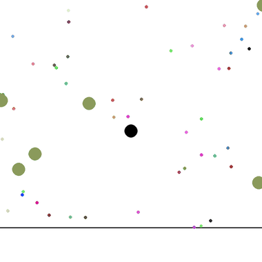

# Multiplayer Cell Eating

A multiplayer cell eating game in Python: eat food and smaller cells to grow, and avoid the bigger ones. The server and the network protocol are written from scratch with raw sockets. Coded by hand before AI, inspired by [Tech With Tim's video on agar.io](https://www.youtube.com/watch?v=SR8xeaRXLcg).

<p align="center">
  
  <br>
  <em>Players are black, bots are green.</em>
</p>

## How it works

**Server and clients.** The [server](Server.py) owns the whole game state (cells and food). A [client](Controller.py) only sends where its mouse points and draws what the server sends back. The server runs one thread per client to receive messages, and one loop at 30 updates per second which moves the bots, checks who eats what, and sends the new state to everyone.

**Protocol.** Everything goes through TCP. Since TCP is a stream, each message starts with a 15 byte header containing its length, followed by the message as text, `TYPE;field;field`:

| Message | Direction | Content |
| --- | --- | --- |
| `UPDATE;dx;dy` | client to server | the move of the player for this frame |
| `ID` / `CREATE` | server to client | the id of the new player, and the existing cells |
| `UPDATE` | server to all | `id,x,y,radius` of every cell |
| `FOOD_UPDATE` | server to all | state and position of every food |
| `INACTIVE;id` | server to all | a cell was eaten or left |

**Rules.** A cell moves towards the mouse with a speed proportional to $1/r$, so big cells are slow. A cell of radius $r_1$ is eaten when it is entirely inside a bigger one of radius $r_2$ (with $d$ the distance between the centers), and the areas add up:

```math
d + r_1 < r_2, \qquad r_2 \leftarrow \sqrt{r_1^2 + r_2^2}
```

Food makes a cell grow by $10/r$ and respawns after 3 seconds.

## Run

Needs `pygame` and Python 3.11 or older.

```bash
python Server.py       # on the server
python Controller.py   # on each player's computer
```

To play on several computers, set `SERVER` to the server's IP address in [`Constants.py`](Constants.py) (localhost by default).
